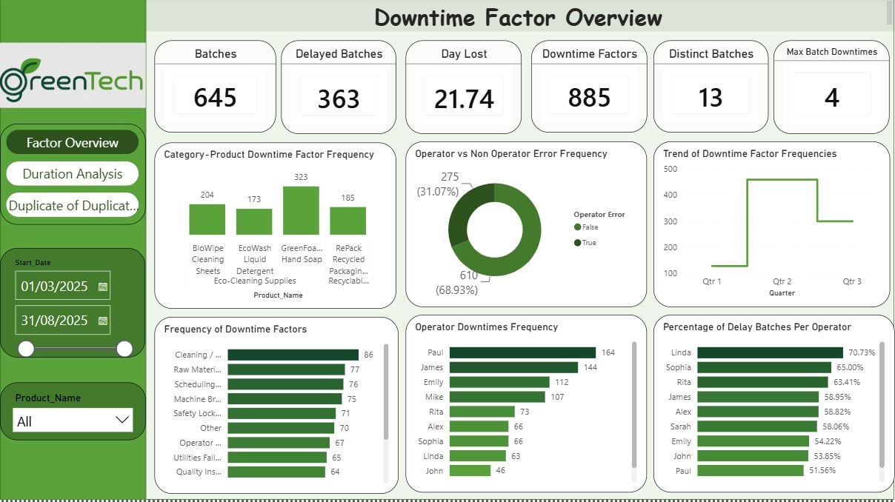
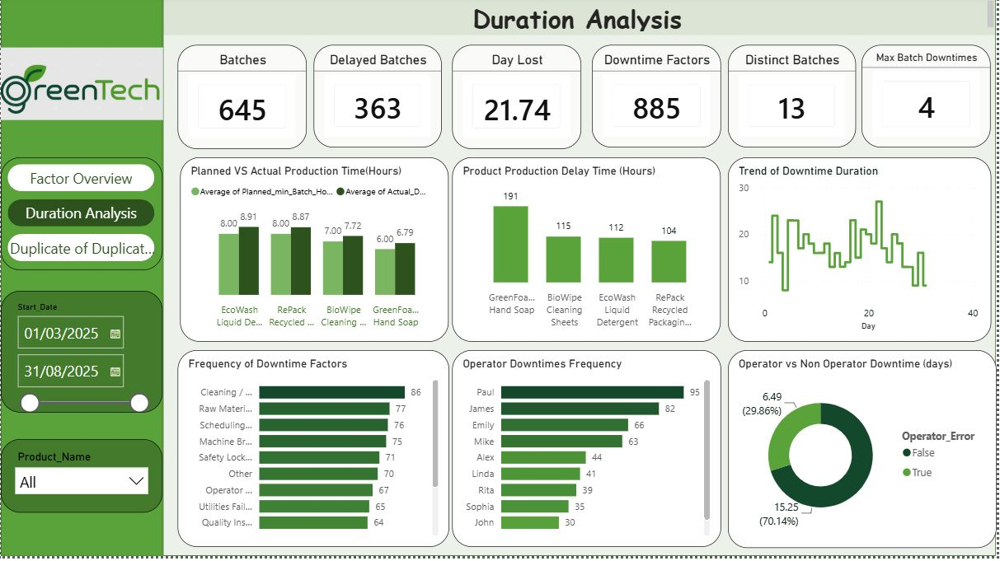
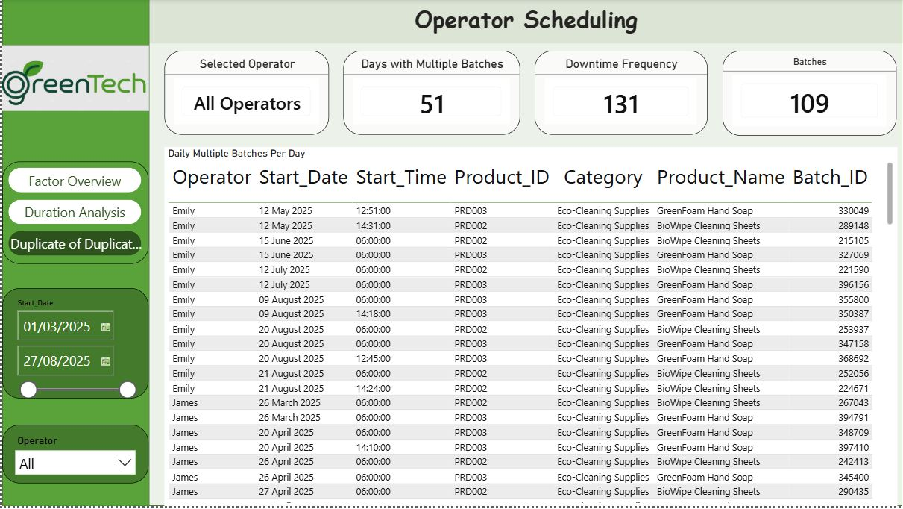

# GreenTech Production Downtime Analysis

An individual manufacturing analytics project using **SQL Server and Power BI** to investigate production delays, downtime factors and operator scheduling.

## Business problem

Production managers need to understand which interruptions affect production, where delays accumulate and how batch assignments vary across operators. Looking at the number of interruptions alone can hide the factors that consume the most time.

This project brings those questions together through SQL analysis and a three-page Power BI report. The overview screenshot covers **645 production batches** between March and August 2025.

## My contribution

I completed this project individually. My work included:

- Assessing four source tables through row counts, null checks and date comparisons.
- Using `UNPIVOT` to transform 13 downtime-factor columns into a structure suitable for analysis.
- Creating views and joining batch, product and downtime-factor data.
- Comparing downtime frequency, recorded delay minutes, planned versus actual production time and the proportion of batches with downtime.
- Developing Power BI pages for factor analysis, duration analysis and operator scheduling, with date, product and operator filters.

**Tools:** SQL Server (T-SQL) · Power BI

**SQL techniques:** joins, common table expressions, views, conditional logic, aggregation, distinct counts, date/time calculations and `UNPIVOT`.

## Findings and recommended actions

- **GreenFoam Hand Soap had the largest displayed downtime burden.** It recorded 323 downtime entries and approximately 191 delay hours in the exported report. Its main interruption factors are a useful starting point for an improvement review.
- **Average actual production time exceeded planned time for all four products shown.** Review recurring interruptions alongside the assumptions used to set planned batch durations.
- **Operator rankings differed between downtime volume and the proportion of affected batches.** Consider workload, frequency and duration together when deciding where further investigation is needed.
- **The scheduling page highlighted multiple batch assignments for the same operator on the same day.** Review the associated start and end times before deciding whether assignments conflict.

These are analytical findings and proposed actions; the project does not claim a measured reduction in downtime.

## Dashboard pages

### 1. Downtime Factor Overview

Compares downtime entries by product and factor, operator-related classifications and the proportion of affected batches by operator.

### 2. Duration Analysis

Compares planned and actual batch duration, product delay hours and the time associated with downtime classifications.

### 3. Operator Scheduling

Shows batch assignments to support a review of operators with multiple batches on the same day.

## Repository contents

| File or folder | Contents |
| --- | --- |
| [sql/GreenTech_Analysis.sql](sql/GreenTech_Analysis.sql) | Portfolio revision of the original assessment, transformation and analysis queries |
| [docs/DATA_DICTIONARY.md](docs/DATA_DICTIONARY.md) | Source fields used in the SQL and the two derived views |
| [docs/SQL_GUIDE.md](docs/SQL_GUIDE.md) | Database requirements, execution steps and calculation definitions |
| [dashboards/](dashboards/) | Three dashboard screenshots |

The screenshots are static exports of the completed report. Source datasets and the Power BI report file are not included. Running the SQL requires the original four tables; see the [SQL guide](docs/SQL_GUIDE.md).

## Author

**Oluwatobiloba Olufowobi**  
[GitHub](https://github.com/OlufowobiJosh) · [LinkedIn](https://www.linkedin.com/in/olufowobi365/)
